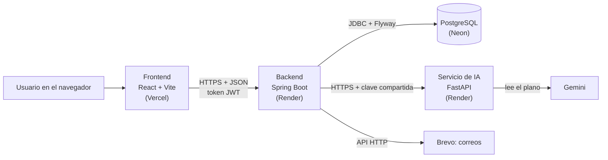

# obraia-backend

API REST de **ObraIA**, plataforma con inteligencia artificial para planear, presupuestar y hacer seguimiento a obras pequeñas.
Proyecto final de Patrones de Software: Kevin Basante y Arley Riascos.

El backend es la única capa que se comunica con la base de datos y con el servicio de IA.
El frontend solo conoce la URL de esta API.

## Arquitectura

El sistema tiene cuatro capas y cada una se despliega por separado:



| Capa | Repositorio | Qué hace |
| ---- | ----------- | -------- |
| Presentación | `obraia-frontend` | Pantallas de la aplicación. Solo habla con este backend |
| Lógica de negocio | `obraia-backend` (este) | Autenticación, obras, planos, fases, cotización, gastos, riesgo y notificaciones |
| Datos | `obraia-backend/src/main/resources/db/migration` | Tablas y datos iniciales de PostgreSQL, creados por Flyway |
| Inteligencia artificial | `obraia-ia` | Lee los planos y devuelve las medidas de cada elemento |

Las claves (base de datos, JWT, Brevo, servicio de IA) solo están en las variables de entorno del backend y de `obraia-ia`.

Dentro del backend, cada petición pasa por: filtro de seguridad (token JWT) → controlador → servicio → repositorio → base de datos.

## Flujo completo

Así se usa ObraIA de principio a fin (es el recorrido de la demostración):

1. **Cuenta:** el usuario se registra, confirma su correo con el enlace e inicia sesión.
2. **Obra:** crea una obra (tipo, ciudad, área y pisos) y, si quiere, agrega a otro usuario como miembro y asigna un maestro de obra.
3. **Planos:** sube una foto o un PDF del plano. La IA lo lee y guarda las medidas de cada elemento; el usuario también puede registrar medidas a mano y compararlas.
4. **Fases:** el sistema crea las fases y tareas según el tipo y el tamaño de la obra (Factory Method y Template Method).
5. **Cotización:** calcula los materiales y el costo con desperdicio, transporte de la ciudad, mano de obra e IVA (Facade y Decorator). Cada cotización se guarda como una versión del presupuesto.
6. **Aprobación:** el usuario aprueba una versión y todos los miembros reciben una notificación.
7. **Seguimiento:** registra los gastos y el avance de las tareas. Después de cada uno se evalúa el riesgo de la obra (Strategy y Observer) y, si se pasa del presupuesto o el riesgo sube, llega una notificación.
8. **Cierre:** al terminar, la obra pasa a `completed`. El usuario puede eliminar una obra o su cuenta con confirmación por correo; los datos se borran para siempre a los 30 días.

## Tecnologías

- Java 17 + Spring Boot 4
- Spring Security con tokens JWT para la autenticación
- PostgreSQL (Neon) con migraciones Flyway
- Brevo (API HTTP) para enviar los correos de la cuenta
- Swagger (springdoc-openapi) para la documentación
- Docker para el despliegue en Render

## Requisitos

- Java 17 o superior
- Git
- PostgreSQL local (opcional, para desarrollo)

No hace falta instalar Maven: el proyecto trae el Maven Wrapper (`mvnw`).

## Instalación

```bash
git clone https://github.com/Kevin-Basante/obraia-backend.git
cd obraia-backend
```

## Variables de entorno

1. Copia `.env.example` y renómbralo a `.env`.
2. Completa los valores de tu base de datos (local o Neon).

El archivo `.env` está en `.gitignore` y **nunca** se sube a GitHub.

| Variable       | Descripción                                                             |
| -------------- | ----------------------------------------------------------------------- |
| `DB_URL`       | Conexión JDBC, por ejemplo `jdbc:postgresql://localhost:5432/obraia_dev` |
| `DB_USER`      | Usuario de la base de datos                                             |
| `DB_PASSWORD`  | Contraseña de la base de datos                                          |
| `FRONTEND_URL` | Orígenes del frontend permitidos (CORS), separados por comas. El primero se usa en los enlaces de los correos |
| `JWT_SECRET`   | Clave para firmar los tokens: texto aleatorio de al menos 32 caracteres  |
| `MAIL_PROVIDER`| `log` muestra los correos en la consola (desarrollo); `brevo` los envía   |
| `MAIL_FROM`    | Remitente de los correos (debe estar verificado en Brevo)               |
| `BREVO_API_KEY`| Clave de la API de Brevo (solo si `MAIL_PROVIDER=brevo`)                |
| `STORAGE_PROVIDER` | Dónde se guardan los planos: `database` (por defecto) o `local` (carpeta `uploads/`) |
| `AI_SERVICE_URL` | URL del servicio de IA (`obraia-ia`), por ejemplo `http://localhost:8000`. Vacía apaga el análisis de planos |
| `AI_SERVICE_TOKEN` | Clave compartida con el servicio de IA (su `SERVICE_TOKEN`) |
| `PORT`         | Puerto del servidor (por defecto 8080; Render lo asigna solo)           |

## Comandos

| Comando (Windows)                 | Comando (Mac / Linux)          | Qué hace                                  |
| --------------------------------- | ------------------------------ | ----------------------------------------- |
| `.\mvnw.cmd spring-boot:run`      | `./mvnw spring-boot:run`       | Inicia el servidor en modo desarrollo     |
| `.\mvnw.cmd test`                 | `./mvnw test`                  | Ejecuta las pruebas y genera el informe de cobertura |
| `.\mvnw.cmd package -DskipTests`  | `./mvnw package -DskipTests`   | Genera el `.jar` en `target/`             |

Al arrancar, Flyway crea las tablas y carga los datos iniciales si todavía no existen.

## Pruebas

Son **562 pruebas** automáticas y ninguna necesita base de datos ni internet, así que se pueden correr en cualquier PC:

| Tipo | Qué revisan | Ejemplo |
| ---- | ----------- | ------- |
| Reglas de negocio | Servicios, entidades, cotización, riesgo y planificación, con repositorios falsos (Mockito) | `QuotationFacadeTest`, `RiskEvaluatorTest` |
| Controladores | Códigos HTTP, validaciones y forma del JSON de error (MockMvc) | `ProjectControllerTest` |
| Seguridad | La cadena de seguridad real: rutas públicas, tokens vencidos o falsos y CORS | `SecurityRulesTest` |
| Servicios externos | Brevo y el servicio de IA contra servidores falsos: no sale ningún correo ni llamada real | `BrevoEmailSenderTest`, `AiServiceAdapterTest` |

**Cobertura:** las pruebas recorren el 91 % de las líneas y el 84 % de las ramas del código.
Después de `mvnw test`, el informe está en `target/site/jacoco/index.html` (se abre con el navegador).

## Endpoints

| Método | Ruta             | Respuesta                                                                                |
| ------ | ---------------- | ---------------------------------------------------------------------------------------- |
| GET    | `/`              | Información general de la API                                                            |
| GET    | `/api/health`    | Estado del servidor y de la base de datos (200 si está conectada, 503 si no)             |
| GET    | `/api/hello`     | "Hello world" con datos leídos de la base de datos (503 si la base no responde)          |
| GET    | `/api/docs`      | Documentación interactiva (Swagger)                                                      |
| GET    | `/api/docs.json` | Documento OpenAPI en JSON                                                                |

### Autenticación (públicos)

| Método | Ruta                             | Qué hace                                                        |
| ------ | -------------------------------- | --------------------------------------------------------------- |
| POST   | `/api/auth/register`             | Crea la cuenta y envía el correo de verificación (201)          |
| POST   | `/api/auth/verify-email`         | Confirma el correo con el token del enlace                      |
| POST   | `/api/auth/resend-verification`  | Envía un nuevo enlace de verificación (202)                     |
| POST   | `/api/auth/login`                | Inicia sesión y devuelve el token de acceso y el de renovación  |
| POST   | `/api/auth/refresh`              | Entrega tokens nuevos con el token de renovación                |
| POST   | `/api/auth/logout`               | Cierra la sesión (revoca el token de renovación) (204)          |
| POST   | `/api/auth/forgot-password`      | Envía el enlace para cambiar la contraseña (202)                |
| POST   | `/api/auth/reset-password`       | Cambia la contraseña con el token del enlace                    |

### Catálogos (públicos, solo lectura)

| Método | Ruta                                                | Qué hace                                                            |
| ------ | --------------------------------------------------- | ------------------------------------------------------------------- |
| GET    | `/api/catalogs/project-types`                       | Tipos de obra                                                       |
| GET    | `/api/catalogs/project-types/{id}`                  | Un tipo de obra                                                     |
| GET    | `/api/catalogs/project-types/{id}/phases`           | Fases estándar y duración total (`?size=small` o `?area=95`)        |
| GET    | `/api/catalogs/project-types/{id}/material-formulas` | Consumo de materiales por elemento (`?element=wall`)               |
| GET    | `/api/catalogs/locations`                           | Ciudades con su % de transporte (`?department=Antioquia`, `?search=bogota`) |
| GET    | `/api/catalogs/locations/departments`               | Departamentos con ciudades                                          |
| GET    | `/api/catalogs/material-categories`                 | Categorías de materiales                                            |
| GET    | `/api/catalogs/materials`                           | Materiales con precio de referencia (`?category=steel`, `?search=arena`) |
| GET    | `/api/catalogs/materials/{id}`                      | Un material                                                         |
| GET    | `/api/catalogs/element-types`                       | Elementos que se miden, su unidad (m³ o m²) y las medidas que necesitan |

### Usuario (requieren token)

| Método | Ruta                             | Qué hace                                                      |
| ------ | -------------------------------- | ------------------------------------------------------------- |
| GET    | `/api/users/me`                  | Datos del usuario que inició sesión                           |
| PUT    | `/api/users/me`                  | Cambiar nombre, apellido y teléfono                           |
| POST   | `/api/users/me/password`         | Cambiar la contraseña (pide la actual y cierra las sesiones)  |
| GET    | `/api/users/me/deletion-impact`  | Lo que se perdería al eliminar la cuenta                      |
| POST   | `/api/users/me/deletion-request` | Pedir la eliminación con la contraseña; envía el correo       |
| POST   | `/api/users/deletion/confirm`    | Confirmar la eliminación con el token del correo (pública)    |

### Obras (requieren token)

| Método | Ruta                                  | Qué hace                                                        |
| ------ | ------------------------------------- | --------------------------------------------------------------- |
| POST   | `/api/projects`                       | Crear una obra (queda en borrador)                              |
| GET    | `/api/projects`                       | Mis obras, de la más nueva a la más vieja (`?status=draft`, `?search=casa`) |
| GET    | `/api/projects/{id}`                  | Datos completos de una obra                                     |
| PUT    | `/api/projects/{id}`                  | Editar una obra                                                 |
| PATCH  | `/api/projects/{id}/status`           | Cambiar el estado (`{ "status": "in_progress" }`)               |
| PUT    | `/api/projects/{id}/site-manager`     | Asignar un maestro de obra                                      |
| DELETE | `/api/projects/{id}/site-manager`     | Quitar el maestro de obra                                       |
| GET    | `/api/projects/{id}/members`          | Personas que administran la obra                                |
| POST   | `/api/projects/{id}/members`          | Agregar a un usuario registrado por su correo                   |
| DELETE | `/api/projects/{id}/members/{userId}` | Quitar a una persona de la obra                                 |
| GET    | `/api/projects/{id}/deletion-impact`  | Lo que se perdería al eliminar la obra                          |
| POST   | `/api/projects/{id}/deletion-request` | Enviar el correo para confirmar la eliminación                  |
| POST   | `/api/projects/deletion/confirm`      | Confirmar la eliminación con el token del correo (pública)      |

### Planos (requieren token)

| Método | Ruta                                           | Qué hace                                                  |
| ------ | ---------------------------------------------- | --------------------------------------------------------- |
| GET    | `/api/projects/{id}/blueprints`                | Planos de la obra, del más nuevo al más viejo             |
| POST   | `/api/projects/{id}/blueprints`                | Subir un plano (`multipart/form-data`, campo `file`)      |
| GET    | `/api/projects/{id}/blueprints/{planoId}/file` | Abrir el archivo del plano                                |
| DELETE | `/api/projects/{id}/blueprints/{planoId}`      | Borrar un plano (sus medidas se conservan)                |
| POST   | `/api/projects/{id}/blueprints/{planoId}/analyze` | Leer el plano con la IA y guardar sus medidas          |

### Medidas (requieren token)

| Método | Ruta                                              | Qué hace                                                 |
| ------ | ------------------------------------------------- | -------------------------------------------------------- |
| GET    | `/api/projects/{id}/measurements`                 | Medidas de la obra (`?floor=1`, `?element=wall`)         |
| POST   | `/api/projects/{id}/measurements`                 | Agregar una medida manual                                |
| PUT    | `/api/projects/{id}/measurements/{medidaId}`      | Editar una medida manual                                 |
| DELETE | `/api/projects/{id}/measurements/{medidaId}`      | Borrar una medida manual                                 |
| GET    | `/api/projects/{id}/measurements/comparison`      | Totales manuales contra los de la IA, por elemento y piso |

### Fases y tareas (requieren token)

| Método | Ruta                                               | Qué hace                                                      |
| ------ | -------------------------------------------------- | ------------------------------------------------------------- |
| GET    | `/api/projects/{id}/phases`                        | Fases con sus tareas y el avance de la obra                   |
| GET    | `/api/projects/{id}/phases/preview`                | Ver las fases que tendría el plan, sin guardarlas             |
| POST   | `/api/projects/{id}/phases/generate`               | Crear el plan con las fases estándar del tipo de obra         |
| DELETE | `/api/projects/{id}/phases`                        | Borrar el plan (solo si no tiene reportes de avance)          |
| PUT    | `/api/projects/{id}/phases/{faseId}`               | Cambiar el nombre o las fechas planeadas de una fase          |
| PATCH  | `/api/projects/{id}/phases/{faseId}/status`        | Cambiar el estado de una fase                                 |
| POST   | `/api/projects/{id}/tasks`                         | Agregar una tarea a una fase                                  |
| PUT    | `/api/projects/{id}/tasks/{tareaId}`               | Editar una tarea (o pasarla a otra fase)                      |
| DELETE | `/api/projects/{id}/tasks/{tareaId}`               | Borrar una tarea con sus reportes                             |
| PATCH  | `/api/projects/{id}/tasks/{tareaId}/status`        | Cambiar el estado de una tarea                                |
| GET    | `/api/projects/{id}/tasks/{tareaId}/progress`      | Reportes de avance de la tarea, del más nuevo al más viejo    |
| POST   | `/api/projects/{id}/tasks/{tareaId}/progress`      | Reportar el avance de la tarea (0 a 100 %)                    |

### Presupuestos (requieren token)

| Método | Ruta                                               | Qué hace                                                      |
| ------ | -------------------------------------------------- | ------------------------------------------------------------- |
| GET    | `/api/projects/{id}/budgets`                       | Versiones del presupuesto, de la más nueva a la más vieja     |
| GET    | `/api/projects/{id}/budgets/preview`               | Cotizar la obra sin guardar                                   |
| POST   | `/api/projects/{id}/budgets`                       | Cotizar la obra y guardarla como una versión nueva (borrador) |
| GET    | `/api/projects/{id}/budgets/{presupuestoId}`       | Una versión con sus filas (una por capa de costo)             |
| POST   | `/api/projects/{id}/budgets/{presupuestoId}/approve` | Aprobar un borrador; el aprobado anterior queda reemplazado |
| GET    | `/api/projects/{id}/materials`                     | Materiales de la última cotización, con desperdicio           |

### Gastos (requieren token)

| Método | Ruta                                               | Qué hace                                                      |
| ------ | -------------------------------------------------- | ------------------------------------------------------------- |
| GET    | `/api/projects/{id}/expenses`                      | Gastos de la obra, del más nuevo al más viejo                 |
| GET    | `/api/projects/{id}/expenses/summary`              | Total gastado por categoría, comparado con el presupuesto aprobado |
| POST   | `/api/projects/{id}/expenses`                      | Registrar un gasto                                            |
| DELETE | `/api/projects/{id}/expenses/{gastoId}`            | Borrar un gasto registrado por error                          |

### Riesgo (requieren token)

| Método | Ruta                                               | Qué hace                                                      |
| ------ | -------------------------------------------------- | ------------------------------------------------------------- |
| GET    | `/api/projects/{id}/risk`                          | Última evaluación de riesgo y la historia del puntaje         |
| POST   | `/api/projects/{id}/risk/assess`                   | Evaluar el riesgo en este momento                             |

### Dashboard (requieren token)

| Método | Ruta                                               | Qué hace                                                      |
| ------ | -------------------------------------------------- | ------------------------------------------------------------- |
| GET    | `/api/dashboard`                                   | Todas mis obras con su avance, dinero y riesgo, y los totales |
| GET    | `/api/dashboard/projects/{id}`                     | Resumen de una obra: plan, próximas tareas, dinero, riesgo y conteos |

### Notificaciones (requieren token)

| Método | Ruta                                     | Qué hace                                         |
| ------ | ---------------------------------------- | ------------------------------------------------ |
| GET    | `/api/notifications`                     | Mis últimas 50 notificaciones, de la más nueva a la más vieja |
| GET    | `/api/notifications/unread-count`        | Cuántas no he leído (el número de la campana)    |
| PATCH  | `/api/notifications/{id}/read`           | Marcar una como leída                            |
| POST   | `/api/notifications/read-all`            | Marcar todas como leídas                         |

### Maestros de obra (requieren token)

| Método | Ruta                       | Qué hace                         |
| ------ | -------------------------- | -------------------------------- |
| GET    | `/api/site-managers`       | Mis maestros de obra             |
| POST   | `/api/site-managers`       | Guardar un maestro de obra       |
| PUT    | `/api/site-managers/{id}`  | Editar un maestro de obra        |
| DELETE | `/api/site-managers/{id}`  | Borrar un maestro de obra        |

Las rutas protegidas necesitan el encabezado `Authorization: Bearer <accessToken>`.
En Swagger se usa el botón **Authorize** con el token que devuelve el login.

Los errores siempre responden en JSON con la forma `{ "error": { "code", "message" } }`.
Los errores de validación agregan `fields` con el problema de cada campo.

## Cómo funciona la autenticación

1. **Registro:** la contraseña se guarda cifrada con BCrypt y se envía un enlace de verificación que vence en 24 horas.
2. **Verificación:** el enlace abre el frontend (`/verify-email?token=...`), que llama a `/api/auth/verify-email`. Sin verificar el correo no se puede iniciar sesión.
3. **Inicio de sesión:** devuelve un **token de acceso** (JWT, dura 15 minutos) y un **token de renovación** (dura 7 días).
4. **Renovación:** cuando el token de acceso vence, el frontend llama a `/api/auth/refresh`. Cada token de renovación sirve una sola vez; si alguien reutiliza uno viejo, se cierran todas las sesiones de ese usuario.
5. **Contraseña olvidada:** el enlace vence en 30 minutos. Al cambiar la contraseña se cierran todas las sesiones.

En la base de datos solo se guarda el hash SHA-256 de los tokens, nunca el token. Cada evento (registro, inicio de sesión, intento fallido, cambio de contraseña...) queda en la tabla `auth_audit_logs`.
Los mensajes de "correo enviado" son iguales exista o no la cuenta, para que nadie pueda averiguar qué correos están registrados.

Con `MAIL_PROVIDER=log` los correos no se envían: el enlace aparece en la consola del servidor, para probar en local.

## Cómo funciona la cuenta

- **Perfil:** el usuario cambia su nombre, apellido y teléfono. El correo no se cambia. Un teléfono vacío se borra.
- **Cambiar la contraseña:** pide la contraseña actual y la nueva debe ser distinta. Al cambiarla se cierran todas las sesiones (también la actual), se guarda el evento `password_changed` y llega un correo de aviso.
- **Eliminar la cuenta** (dos pasos, como una obra):
  1. El frontend pide `deletion-impact` y muestra las advertencias: obras que creó el usuario (se eliminan con la cuenta), cuáles de ellas tienen otros miembros (ellos también las pierden) y en cuántas obras de otras personas participa (solo sale de ellas).
  2. El usuario escribe su contraseña. El backend envía un correo con un enlace que vence en 30 minutos. Si el correo no sale, la solicitud se cancela (503).
  3. El enlace abre el frontend (`/confirm-account-deletion?token=...`), que llama a `/api/users/deletion/confirm`. La cuenta ya no puede iniciar sesión, sus obras desaparecen, sale de las obras de otros y se cierran todas sus sesiones.
  4. Los datos se guardan 30 días. Una tarea diaria (4:15 a. m., hora de Colombia, después de la purga de obras) borra la cuenta para siempre. El mismo correo puede registrarse otra vez desde que la cuenta se elimina.
- Las solicitudes y las eliminaciones quedan en `auth_audit_logs` (`deletion_requested`, `account_deleted`).

## Cómo funcionan los catálogos

- Los datos vienen de la migración V3 y no cambian mientras el servidor está encendido. Por eso el backend los guarda en memoria (caché) después de la primera consulta y no vuelve a preguntarle a la base de datos.
- Las respuestas llevan `Cache-Control: max-age=600`, así el navegador puede reutilizarlas durante 10 minutos.
- Las búsquedas ignoran mayúsculas y tildes: `bogota` encuentra "Bogotá" y `rio` encuentra "Arena de río".
- El tamaño de la obra decide sus fases: hasta 120 m² es pequeña (`small`) y más de 120 m² es grande (`large`).
- Un filtro con un valor desconocido responde 400 con la lista de valores válidos; un id que no existe responde 404.

## Cómo funcionan las obras

- Solo los miembros de una obra pueden verla o cambiarla. Para cualquier otra persona la obra responde 404, como si no existiera.
- Quien crea la obra es su primer miembro (rol `owner`) y puede agregar a otros usuarios con cuenta verificada. Al creador no se le puede quitar.
- Estados y cambios permitidos:

  | Estado        | Puede pasar a                          |
  | ------------- | -------------------------------------- |
  | `draft`       | `planned`, `cancelled`                 |
  | `planned`     | `draft`, `in_progress`, `cancelled`    |
  | `in_progress` | `paused`, `completed`, `cancelled`     |
  | `paused`      | `in_progress`, `cancelled`             |
  | `completed`   | ninguno (final)                        |
  | `cancelled`   | ninguno (final)                        |

  La primera vez que una obra pasa a `in_progress` se guarda la fecha real de inicio; al pasar a `completed`, la fecha real de fin. Una obra terminada o cancelada ya no se puede editar.
- La respuesta de una obra trae `nextStatuses`, así el frontend solo ofrece los cambios válidos.
- Cada usuario guarda sus propios maestros de obra. Si borra uno, sus obras quedan sin maestro asignado.

### Eliminar una obra

1. El frontend pide `deletion-impact` y muestra las advertencias: planos, fases, presupuestos, gastos y miembros que tiene la obra.
2. Solo el creador puede pedir la eliminación. El backend envía un correo con un enlace que vence en 30 minutos. Si el correo no sale, la solicitud se cancela (503).
3. El enlace abre el frontend (`/confirm-deletion?token=...`), que llama a `/api/projects/deletion/confirm`. La obra desaparece de la lista de inmediato.
4. Los datos se guardan 30 días por si hubo un error y después una tarea diaria (4:00 a. m., hora de Colombia) los borra para siempre.

## Cómo funcionan los planos y las medidas

- Cada obra puede tener hasta 10 planos de máximo 10 MB: PDF o imagen (PNG, JPG o WEBP). El backend reconoce el tipo por los primeros bytes del archivo, no por el nombre, así que un archivo renombrado a `.pdf` se rechaza.
- Un PDF con texto (hecho en un programa de dibujo) queda como `vector_pdf`; uno sin texto, como `scanned_pdf`. Las fotos quedan como `image`. Todos empiezan en estado `pending`; al analizarlos con la IA quedan `completed` o, si la IA falla, `failed` (se pueden analizar de nuevo).
- **Patrón Bridge:** los servicios guardan los archivos a través de la interfaz `BlueprintStorage`, sin saber dónde quedan. Hay dos implementaciones:
  - `DatabaseBlueprintStorage` (`STORAGE_PROVIDER=database`): guarda los bytes en la tabla `blueprint_files` (migración V4). Es la que se usa en Render, porque su plan gratuito borra el disco en cada despliegue.
  - `LocalBlueprintStorage` (`STORAGE_PROVIDER=local`): guarda los archivos en la carpeta `uploads/`, que no se sube a Git.
- Cada medida es de un elemento de la obra en un piso. Las medidas que necesita dependen del elemento:

  | Elemento                                   | Unidad | Medidas          | Cantidad calculada        |
  | ------------------------------------------ | ------ | ---------------- | ------------------------- |
  | Cimentación, columnas, vigas, losas        | m³     | largo, ancho, alto | largo × ancho × alto × cantidad |
  | Muros                                      | m²     | largo, alto      | largo × alto × cantidad   |
  | Piso y cubierta                            | m²     | largo, ancho     | largo × ancho × cantidad  |

- El piso no puede ser mayor que los pisos de la obra. Si falta una medida, la respuesta 400 indica el campo en `fields`.
- Las medidas leídas por la IA (fuente `ocr`) no se pueden editar ni borrar. La comparación suma cada elemento por piso y marca `match` si la diferencia es de 10 % o menos y `review` si es mayor. Mientras la IA no mida, cada fila sale como `manual_only`.
- Una obra terminada o cancelada no acepta planos ni medidas nuevas, pero se pueden seguir consultando.
- Al borrar una obra para siempre (tarea de las 4:00 a. m.) también se borran los archivos de sus planos.

## Cómo funciona la lectura de planos con IA

La IA vive en otro servicio, `obraia-ia` (Python con FastAPI y Gemini), porque el curso pide que esté separada. El backend lo llama así:

```text
BlueprintAnalysisService / QuotationFacade  →  AiServiceProxy  →  AiServiceAdapter  →  obraia-ia  →  Gemini
```

- **Patrón Adapter:** `AiServiceAdapter` es el único que sabe cómo se llama a `obraia-ia`: arma el formulario `multipart/form-data` con el plano y los pisos, envía la clave en `X-Service-Token`, lee la respuesta en `snake_case` y la traduce a clases del backend (`ElementType`, `BigDecimal` con dos decimales). Los elementos que el backend no conoce se cuentan como descartados. Si el servicio falla, no responde a tiempo o su respuesta no se puede leer, lanza 502 `AI_SERVICE_FAILED` con el mensaje que mandó `obraia-ia` (por ejemplo, `The AI service answered 502: Gemini answered 400: ...`). Si `obraia-ia` responde `ANALYZER_BUSY` (Gemini sigue saturado después de sus reintentos), lanza 503 `AI_SERVICE_BUSY`: el plano queda como fallido y se puede analizar de nuevo más tarde.
- **Patrón Proxy:** `AiServiceProxy` tiene la misma interfaz (`AiServiceClient`) y se pone delante del adaptador, así que quien lo usa no nota la diferencia. Hace tres cosas:
  - **Protección:** si `AI_SERVICE_URL` está vacía responde 503 `AI_SERVICE_DISABLED`, y cada obra puede llamar a la IA máximo 5 veces por hora (`app.ai.max-analyses-per-project`), porque el plan gratuito del modelo tiene cuota. Al pasarse responde 429 `AI_LIMIT_REACHED`. Solo cuentan los análisis que funcionan: si la IA falla o está saturada, el intento se devuelve.
  - **Caché:** guarda en memoria los últimos 50 análisis por el contenido del archivo (SHA-256) y los pisos. El mismo plano no se envía dos veces: la respuesta sale de la caché (`cached: true`) y no cuenta para el límite.
  - **Carga perezosa:** el adaptador es un bean `@Lazy`; se crea la primera vez que hay que leer un plano, no al arrancar.
- **Análisis** (`POST .../blueprints/{planoId}/analyze`): guarda lo que leyó la IA como medidas con fuente `ocr` ligadas al plano y deja el plano en `completed`. Analizar otra vez reemplaza las medidas que la IA había leído de ese plano. Las medidas en un piso que la obra no tiene se descartan.
- **Diferencia con lo manual:** cada medida de la IA guarda en `discrepancy_pct` cuánto se aleja el total de la IA del total manual para ese elemento y piso (vacío si no hay medidas manuales).
- La primera llamada después de un rato puede tardar cerca de un minuto, porque Render apaga `obraia-ia` cuando no se usa (el tiempo de espera es de 150 segundos).

## Cómo funcionan las fases y las tareas

- **Patrón Factory Method:** cada tipo de obra tiene su fábrica, que hereda de `ProjectCalculatorFactory` y decide qué planificador de fases crear (`createPhasePlanner()`):
  - `HouseCalculatorFactory` (Vivienda unifamiliar) crea `HousePhasePlanner`.
  - `CommercialUnitCalculatorFactory` (Local comercial) crea `CommercialUnitPhasePlanner`, que agrega al final la fase "Adecuación comercial (fachada, vitrina y cortina metálica)" (7 días hábiles en obra pequeña, 10 en grande).
  - La misma fábrica crea el calculador de materiales (`createMaterialCalculator()`), que usa la cotización. Los dos tipos usan hoy `StandardMaterialCalculator`.
  - Los servicios solo llaman a `planPhases(...)` y `calculateMaterials(...)`, así que un tipo de obra nuevo es una clase nueva, sin cambiar los servicios.
- El plan parte de las fases estándar del catálogo según el tamaño de la obra (pequeña hasta 120 m², grande desde ahí). Cada fase trae sus tareas iniciales, que se pueden editar, borrar o completar con tareas nuevas.
- Las fechas se calculan en días hábiles de lunes a sábado desde la fecha de inicio planeada de la obra; si la obra no tiene fecha, las fases quedan sin fechas. Cada fase empieza el día hábil siguiente al fin de la anterior.
- Estados de fases y tareas: `planned` → `in_progress` → `delayed` o `completed`. Una tarea o fase completada se puede reabrir (`in_progress`). Una fase o tarea está atrasada (`late`) si pasó su fecha de fin planeada y no está completada.
- Reportar avance mueve la tarea: más de 0 % la inicia y 100 % la completa. La fase empieza con su primera tarea y se completa sola cuando todas sus tareas están completas. Una fase no se puede completar a mano si le faltan tareas.
- El avance de una tarea es su último reporte (por fecha del reporte). Una tarea completada cuenta siempre como 100 %, aunque se haya completado con su botón y nadie la haya reportado; si se reabre, vuelve a su último reporte. El avance de una fase es el promedio de sus tareas y el de la obra es el promedio de todas las tareas.
- El reporte puede indicar que lo dio el maestro de obra asignado (`fromSiteManager: true`); si la obra no tiene maestro asignado, la respuesta es 400. La fecha del reporte no puede ser futura y, si no se envía, es hoy (hora de Colombia).
- El plan solo se puede crear una vez (409 `PHASES_ALREADY_CREATED`) y solo se puede borrar mientras no tenga reportes (409 `PHASES_HAVE_PROGRESS`).

## Cómo funciona la cotización

- **Patrón Facade:** `QuotationFacade.quoteProject(obra)` es la única llamada que hace el servicio de presupuestos. Por dentro elige las medidas, pide las cantidades a la fábrica del tipo de obra, toma el % de transporte de la ciudad y los días hábiles del plan, y arma las capas de costo.
- **Qué medidas usa:** las manuales si hay; si no, las que la IA ya leyó; si tampoco hay, le pide a la IA (a través de `AiServiceProxy`) que lea el plano más nuevo de la obra. `measurementSource` en la respuesta dice si se cotizó con medidas `manual` u `ocr`.
- **Cantidades:** para cada elemento medido se suma su cantidad (m³ o m²) y se multiplica por el consumo de cada fórmula de ese elemento (por ejemplo 12,5 bloques por m² de muro). El desperdicio de cada fórmula (5 % o 10 %) se calcula aparte.
- **Patrón Decorator:** el costo es un `CostComponent`. `MaterialsCost` es el componente base y cada decorador lo envuelve y agrega una capa:

  | Orden | Capa                       | Cómo se calcula                                                        |
  | ----- | -------------------------- | ---------------------------------------------------------------------- |
  | 1     | `MaterialsCost` (materiales) | Cantidad exacta × precio de referencia (el precio ya incluye IVA)      |
  | 2     | `WasteCost` (desperdicio)  | Material extra por roturas y cortes, según el desperdicio de cada fórmula |
  | 3     | `TransportCost` (transporte) | % de la ciudad sobre materiales y desperdicio (3 % en Bogotá, 6 % en Pasto) |
  | 4     | `LaborCost` (mano de obra) | Días hábiles × costo diario de la cuadrilla (`app.quotation.labor-daily-rate`, $280.000) |
  | 5     | `TaxCost` (IVA)            | 19 % sobre mano de obra y transporte (`app.quotation.vat-pct`)          |

  Cada capa es una fila del presupuesto (`budget_items`). Agregar una capa nueva (por ejemplo imprevistos) es un decorador nuevo, sin tocar los demás.
- **Días hábiles:** si la obra ya tiene fases con fechas, se cuentan los días hábiles entre la primera y la última; si no, se suman las duraciones de las fases estándar del tipo de obra (`workingDaysSource` dice cuál se usó).
- **Patrón Builder:** el resultado (`Quotation`) se arma paso a paso con `Quotation.builder()`, porque tiene muchas partes; `build()` revisa que estén las obligatorias.
- Cada cotización guardada es una versión nueva en borrador (`draft`) y reemplaza la lista de materiales de la obra (`project_materials`) con el precio de ese momento. Al aprobar una versión, la aprobada antes pasa a `superseded`; la base de datos solo permite un presupuesto aprobado por obra.
- La migración V5 agrega el % de transporte a cada ciudad y los tipos de fila `waste` y `transport`.
- Errores: sin medidas (ni manuales, ni de la IA, ni planos que leer) responde 409 `NO_MEASUREMENTS`; si ningún elemento medido tiene fórmulas, 409 `NO_MATERIAL_FORMULAS`; aprobar algo que no es borrador, 409 `BUDGET_NOT_DRAFT`.

## Cómo funcionan los gastos

- Un gasto es dinero que ya se pagó en la obra. Tiene categoría (`materials`, `labor`, `equipment`, `tax` u `other`), descripción, valor, fecha y, si se quiere, la fase a la que pertenece.
- La fecha no puede ser futura y, si no se envía, es hoy (hora de Colombia). La fase tiene que ser de la misma obra. En una obra completada o cancelada no se pueden registrar ni borrar gastos (409 `PROJECT_CLOSED`).
- Cada vez que se registra o se borra un gasto, el total gastado se copia en el `actual_amount` del presupuesto aprobado. Al aprobar una versión nueva, esta empieza con lo que ya se había gastado.
- El resumen (`/expenses/summary`) muestra el total gastado, el presupuesto aprobado, lo que queda (negativo si ya se pasó), el % gastado y el total de cada categoría, de la más grande a la más pequeña.
- No hace falta una migración nueva: las tablas `expenses`, `risk_assessments` y `notifications` ya estaban en la V2.

## Cómo funciona el riesgo

- **Patrón Strategy:** cada regla de riesgo es una clase que implementa `RiskStrategy` y le pone a la obra un puntaje de 0 a 100. `RiskEvaluator` recibe todas las estrategias que Spring encuentra y las combina, sin saber qué hace cada una. Una regla nueva es una clase nueva, sin cambiar el evaluador.

  | Estrategia              | Código           | Peso | Qué mira                                                          |
  | ----------------------- | ---------------- | ---- | ----------------------------------------------------------------- |
  | `ScheduleDelayStrategy` | `schedule_delay` | 35 % | Tareas (o fases sin tareas) que pasaron su fecha de fin sin completarse |
  | `ProgressPaceStrategy`  | `progress_pace`  | 25 % | % del tiempo planeado que ya pasó contra % de la obra hecho       |
  | `BudgetOverrunStrategy` | `budget_overrun` | 25 % | % del presupuesto aprobado que ya se gastó (sube desde el 90 %)   |
  | `SpendingPaceStrategy`  | `spending_pace`  | 15 % | % gastado contra % de la obra hecho                               |

- **Puntaje final:** la mitad es el promedio ponderado de las cuatro reglas y la otra mitad es la regla más alta, para que un solo problema grave no quede escondido. El nivel sale del puntaje: `low` (menos de 25), `medium` (25 a 49,99), `high` (50 a 74,99) y `critical` (75 o más).
- **Días de atraso esperados:** el mayor entre los días de atraso de la tarea más atrasada y los días que faltan para alcanzar el ritmo planeado.
- Cada regla devuelve su puntaje, su peso, sus días de atraso y una frase que explica el resultado (`detail`), por ejemplo `105% of the approved budget is spent`. Con la frase van su código (`detailCode`, por ejemplo `budget_spent`) y sus valores (`detailParams`, por ejemplo `{ "spent": "105" }`), para que el frontend la escriba en español o en inglés. Se guardan como JSON en la columna `risk_factors`.
- El riesgo se evalúa solo después de cada gasto (`expense`), de cada reporte de avance y de cada tarea completada o reabierta con su botón (`progress_report`), y también cuando un miembro lo pide (`manual`). Las obras completadas o canceladas no se evalúan solas. Cada evaluación se guarda, así que la respuesta trae la última y la historia (las últimas 20, de la más vieja a la más nueva) para dibujar la gráfica.
- La versión del modelo es `rules-v1` (reglas fijas, sin IA).

## Cómo funciona el dashboard

- El servicio `ProjectOverviewService` junta en una sola respuesta lo que dicen el plan, los presupuestos, los gastos, el riesgo y las medidas, para que la pantalla no tenga que pedir cada parte por separado.
- **Dashboard de una obra** (`/api/dashboard/projects/{id}`):
  - `work`: avance de la obra, fechas del plan, fases y tareas completadas, tareas atrasadas, la fase actual (la primera que está en curso o, si ninguna lo está, la primera pendiente), el avance de cada fase y las próximas 5 tareas sin completar (primero las atrasadas, luego por fecha de inicio).
  - `money`: versión aprobada, cuántas versiones se cotizaron, presupuesto aprobado, total gastado, lo que queda, el % gastado y el total de cada categoría de gasto. Sin presupuesto aprobado, la comparación llega en `null`.
  - `risk`: nivel, puntaje y días de atraso esperados de la última evaluación (`null` antes de la primera).
  - `counts`: planos, medidas a mano, medidas de la IA y miembros.
- **Dashboard de todas las obras** (`/api/dashboard`): una tarjeta por obra (la más nueva primero) con su avance, presupuesto aprobado, gastado, % gastado y riesgo, y arriba los totales: cuántas obras hay, cuántas están en curso, cuántas tienen riesgo alto o crítico, la suma de los presupuestos aprobados y la de los gastos.
- Solo se ven las obras de las que el usuario es miembro; la obra de otra persona responde 404.

## Cómo funcionan las notificaciones

- **Patrón Observer:** los servicios publican eventos de Spring y no saben quién los escucha. `ProjectNotifications` los escucha con `@TransactionalEventListener`, después de que el cambio queda guardado, y avisa a todos los miembros de la obra:

  | Evento                | Lo publica                     | Notificación                                                   |
  | --------------------- | ------------------------------ | -------------------------------------------------------------- |
  | `BudgetApprovedEvent` | `BudgetService` al aprobar     | `budget_approved`: versión aprobada y su valor                 |
  | `BudgetExceededEvent` | `ExpenseService`               | `budget_deviation`: cuando los gastos pasan el presupuesto aprobado; no se repite mientras sigan por encima |
  | `RiskAssessedEvent`   | `RiskAssessmentService`        | `delay_risk`: solo cuando el riesgo llega a `high` o `critical` y subió de nivel |

- Con el mismo patrón, `RiskTriggers` escucha `ExpensesChangedEvent` y `ProgressReportedEvent` para evaluar el riesgo otra vez.
- Los dos observadores trabajan en su propia transacción: si fallan, el error queda en el log y el gasto, el reporte o la aprobación no se pierden.
- Cada usuario solo ve y marca sus propias notificaciones; la de otro usuario responde 404 `NOTIFICATION_NOT_FOUND`.

## Textos en dos idiomas

El frontend se puede ver en español o en inglés. El backend no traduce: envía códigos y los valores de cada frase, y el frontend arma la frase en el idioma elegido. El texto en inglés se sigue enviando para otros clientes y para los datos viejos.

| Dónde | Qué se envía además del texto |
| ----- | ----------------------------- |
| Errores | `error.code` (ya existía) y, cuando el mensaje tiene valores, `error.params` (por ejemplo `BLUEPRINT_LIMIT_REACHED` con `{ "max": "20" }`) |
| Mensajes de la cuenta y de eliminación | `code` y `params` en `MessageResponse` (por ejemplo `project_deleted` con la obra y la fecha de borrado) |
| Reglas de riesgo | `detailCode` y `detailParams` en cada regla |
| Notificaciones | `params` con los valores del mensaje (obra, versión, montos, nivel, razón principal), guardados en la columna `params` |
| Filas del presupuesto | `params` con la ciudad, los días y la tarifa o la cantidad de materiales, guardados en la columna `params` |

- La migración **V6** agrega la columna `params` (`jsonb`) a `notifications` y `budget_items`. Para las filas que ya existían, saca los valores de su texto en inglés (presupuestos, aprobaciones y gastos por encima del presupuesto).
- La migración **V7** hace lo mismo con el riesgo: a las evaluaciones y notificaciones de riesgo guardadas antes de V6 les agrega el código y los valores de cada frase, leyendo su texto en inglés. Una frase que no reconoce queda como estaba.
- `TextParams` (en `util/`) guarda y lee esos valores como JSON.

## Caché

El backend usa la caché de Spring (`@EnableCaching` en `CacheConfig`) guardada en memoria (`ConcurrentMapCacheManager`).

| Caché              | Qué guarda                                   | Cuándo se borra                                               |
| ------------------ | -------------------------------------------- | ------------------------------------------------------------- |
| `projectTypes`, `locations`, `materials`, `phaseTemplates`, `materialFormulas` | Catálogos (`@Cacheable` en los repositorios) | Nunca: solo cambian con migraciones, que reinician el servidor |
| `budgetVersions`   | Versiones del presupuesto de cada obra (`BudgetVersions.list`) | `@CacheEvict` cada vez que se cotiza o se aprueba |
| Análisis de la IA  | Últimos 50 planos leídos, por su contenido (caché propia de `AiServiceProxy`) | Sale el más viejo cuando se llena, o al reiniciar el servidor |

Para borrar `budgetVersions` en el momento correcto se usa el **patrón Observer** con los eventos de Spring: `BudgetService` publica `BudgetChangedEvent` y `BudgetVersions.onBudgetChanged` lo escucha con `@TransactionalEventListener`, que espera a que el cambio quede guardado en la base de datos antes de borrar la caché.
Además, los catálogos responden con `Cache-Control: max-age=600` para que el navegador también los guarde.

## Patrones de diseño

| Patrón          | Dónde                                                                 |
| --------------- | --------------------------------------------------------------------- |
| Facade          | `QuotationFacade`: una sola llamada para cotizar una obra            |
| Decorator       | `CostComponent`, `MaterialsCost` y los decoradores `WasteCost`, `TransportCost`, `LaborCost`, `TaxCost` |
| Factory Method  | `ProjectCalculatorFactory` y una fábrica por tipo de obra (planificador de fases y calculador de materiales) |
| Adapter         | `AiServiceAdapter`: traduce las llamadas y respuestas del servicio de IA en Python |
| Proxy           | `AiServiceProxy`: protección (servicio apagado y límite por obra), caché y carga perezosa del adaptador |
| Builder         | `Quotation.builder()`                                                |
| Bridge          | `BlueprintStorage` con almacenamiento en base de datos o en carpeta  |
| Template Method | `StandardPhasePlanner`: el algoritmo del plan es fijo y cada tipo de obra pone sus tareas y fases extra |
| Strategy        | `RiskStrategy`: cuatro reglas de riesgo que `RiskEvaluator` combina; también `EmailSender` (consola o Brevo según `MAIL_PROVIDER`) |
| Observer        | Eventos de Spring: `RiskTriggers` evalúa el riesgo tras gastos, avances y tareas completadas, `ProjectNotifications` avisa a los miembros y `BudgetVersions` borra la caché |
| Repository, DTO y capas | Repositorios de Spring Data, objetos de `dto/` y controladores → servicios → repositorios |

## Estructura

Arquitectura por capas: controladores → servicios → repositorios → base de datos.

```
database/                  Diagrama entidad-relación y documentación de la base
src/main/java/com/obraia/backend/
├── ai/                    Servicio de IA: interfaz, adaptador (Adapter), proxy (Proxy) y resultados
├── config/                Seguridad, JWT, CORS, correo, almacenamiento, IA, Swagger y propiedades
├── controller/            Reciben la petición y responden con el código HTTP correcto
├── dto/                   Objetos que se reciben y se envían (JSON)
├── email/                 Envío de correos (consola o Brevo)
├── event/                 Eventos de la aplicación (Observer)
├── entity/                Tablas de la base de datos como clases Java (JPA)
├── entity/blueprint/      Planos, medidas y reglas para calcular cada elemento
├── entity/budget/         Presupuestos, sus filas y los materiales de cada obra
├── entity/catalog/        Catálogos: tipos de obra, ciudades, materiales, fases y fórmulas
├── entity/expense/        Gastos y sus categorías
├── entity/notification/   Notificaciones y sus tipos
├── entity/phase/          Fases, tareas, reportes de avance y sus estados
├── entity/project/        Obras, miembros, maestros de obra y solicitudes de eliminación
├── entity/risk/           Evaluaciones de riesgo, niveles y qué las disparó
├── exception/             Errores de la aplicación y manejador global de errores
├── planning/              Fábricas por tipo de obra (Factory Method), planificadores, calculador de materiales y calendario de obra
├── quotation/             Cotización: fachada (Facade), capas de costo (Decorator) y resultado (Builder)
├── repository/            Acceso a la base de datos (patrón Repository)
├── risk/                  Reglas de riesgo (Strategy), foto de la obra y evaluador
├── security/              Tokens JWT, hash de tokens y respuestas 401/403 en JSON
├── service/               Lógica de negocio
├── storage/               Dónde se guardan los archivos de los planos (base de datos o carpeta)
├── util/                  Utilidades (búsqueda sin tildes y valores de las frases en JSON)
├── validation/            Reglas de validación propias (contraseña segura)
└── ObraiaBackendApplication.java   Punto de entrada: inicia el servidor
src/main/resources/
├── application.properties Configuración (lee las variables de entorno)
└── db/migration/          Migraciones de Flyway (V1 a V6)
src/test/                  Pruebas unitarias
```

## Despliegue en Render

El servicio se describe en `render.yaml` (región Ohio, plan gratuito, Docker).

| Configuración     | Valor                         |
| ----------------- | ----------------------------- |
| Language          | `Docker` (usa el `Dockerfile`) |
| Health Check Path | `/api/health`                 |

Variables que se configuran en el panel de Render (no van en el repositorio):

| Variable       | Valor                                                    |
| -------------- | -------------------------------------------------------- |
| `DB_URL`       | Conexión JDBC directa de Neon (sin *connection pooling*) |
| `DB_USER`      | Usuario de Neon                                          |
| `DB_PASSWORD`  | Contraseña de Neon                                       |
| `FRONTEND_URL` | URL del frontend en Vercel (primero) y `http://localhost:5173` |
| `JWT_SECRET`   | Texto aleatorio de al menos 32 caracteres (distinto al local) |
| `MAIL_PROVIDER`| `brevo` (o `log` mientras Brevo no esté configurado)     |
| `MAIL_FROM`    | Correo remitente verificado en Brevo                     |
| `BREVO_API_KEY`| Clave de la API de Brevo                                 |
| `AI_SERVICE_URL` | URL del servicio `obraia-ia` en Render                 |
| `AI_SERVICE_TOKEN` | El mismo valor de `SERVICE_TOKEN` en `obraia-ia`     |

`STORAGE_PROVIDER` no hace falta en Render: por defecto los planos se guardan en la base de datos.

El plan gratuito de Render bloquea el envío de correos por SMTP; por eso se usa la API HTTP de Brevo.

Cada vez que se sube un commit a `main`, Render vuelve a desplegar automáticamente.
En el plan gratuito el servicio se duerme tras unos minutos sin uso: la primera petición después de eso tarda cerca de un minuto.

## Equipo y responsabilidades

| Integrante    | Responsabilidad                                                    |
| ------------- | ------------------------------------------------------------------ |
| Kevin Basante | Backend (este repositorio), base de datos y servicio de IA         |
| Arley Riascos | Frontend (`obraia-frontend`)                                       |

Los dos trabajan juntos en el diseño y revisan el avance de los tres repositorios.

## Convenciones

- Código, comentarios, rutas y claves JSON en inglés; documentación en español.
- Commits con prefijo según el tipo de cambio: `feat:`, `fix:`, `docs:`, `chore:`, `test:`.
- La base de datos solo cambia con migraciones nuevas (ver `database/README.md`).
